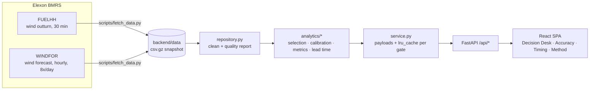

# Architecture and design decisions

## System overview

Deployment targets share one codebase:

| Target | Static UI | API |
|---|---|---|
| Docker / Heroku | FastAPI `StaticFiles` mount | uvicorn in the same container |
| Vercel | `frontend/dist` on the CDN | `api/index.py` serverless function (edge-cached) |
| Local dev | Vite dev server (proxies `/api`) | `uvicorn --reload` |

## Why a bundled snapshot instead of calling Elexon on every request

The pilot scope is fixed (January 2026 decisions), so the data is immutable. Bundling about 230 KB of gzipped CSV:

* makes the app fast and independent of Elexon availability during a demo,
* makes every number reproducible, since tests run against the same data,
* keeps the serverless function stateless.

`scripts/fetch_data.py` is the ETL. A live mode would run it on a schedule and point `WINDDESK_DATA_DIR` at fresh data. The analytics layer does not change.

## Key design decisions

### 1. Decision-time selection is per target hour (`merge_asof`)
For delivery day D and gate G, every hourly target gets the latest forecast with `publishTime ≤ G(D-1)`. Matching per target instead of per publish stays correct even if a publish has gaps. `merge_asof(..., by="start_time", direction="backward")` does it in one vectorised join. Forecast points with a target before their publish time (WINDFOR includes about 5–25 h of hindcast) are never used.

### 2. Like-for-like timestamps
WINDFOR is hourly and FUELHH is half-hourly. Metrics pair each hourly forecast with the settlement period starting at the same `startTime`, which is what the brief implies ("startTime similar to actuals"). This makes no assumption about whether the forecast is an instantaneous or an hourly-average value. Energy totals use every half-hour.

### 3. Calibration with no look-ahead
The raw forecast had a large, persistent positive bias (+1.7 GW in January, +1.4 GW in December), and the bias grows with forecast level. A multiplicative model fits that shape:

* `calibrated = forecast × scale`, where `scale = Σ(a·f) / Σ(f²)` over the trailing window
* `P10/P90 = forecast × 10th/90th percentile of (outturn / forecast)`

The window is the 28 delivery days **fully settled before the gate**: D-29 to D-2, because D-1 is still in progress at a 09:50 gate. Hours forecast below 1 GW are excluded because their ratio is mostly noise. Alternatives tried during exploration (N2EX gate, January):

| Method | MAE | Band coverage |
|---|---:|---:|
| Raw published forecast | 1,996 MW | – |
| Additive bias correction (28-day median) | 1,482 MW | 87% (too wide) |
| Linear regression `a + b·f` | 1,201 MW | 80% |
| **Scale factor `k·f` (chosen)** | **1,218 MW** | **83%** |

The scale factor is nearly as accurate as the regression and has a one-number explanation a trader can repeat ("recently, wind outturn has come in at about 87% of forecast"). That made it the right pilot choice.

### 4. Baseline
Persistence (the last settled outturn at the gate, held flat) gives a floor that any forecast must beat. Skill = 1 − MAE / MAE(persistence).

### 5. Caching
Every analytics result is a pure function of the gate time, and the dataset is immutable. `lru_cache` on `decision_frame(gate_time)` makes repeat requests take milliseconds. The "when to decide" sweep (50 gate times: every half-hour plus 09:20 and 09:50) is about 2.5 s cold, once per process. On Vercel, `Cache-Control: s-maxage=86400` lets the edge serve repeat requests without invoking Python.

### 6. Time zones
Everything is stored in UTC. Delivery days and gates are defined in `Europe/London` and converted per day, so the app stays correct across clock changes (tested: 23 h and 25 h days). The UI formats all times in UK local time with `Intl.DateTimeFormat`.

## API

| Endpoint | Purpose |
|---|---|
| `GET /api/meta` | Decision window, gates, calibration settings, provenance and quality |
| `GET /api/decision?decision_date=YYYY-MM-DD&gate_time=HH:MM` | Decision view: forecast used, calibration, band, hourly and half-hourly series, all vintages |
| `GET /api/accuracy?gate_time=HH:MM` | Back-test summary, daily rows, hour-of-day, histogram, hourly timeseries |
| `GET /api/lead-time` | Error by lead time, gate comparison, decision-time sweep |
| `GET /api/export.csv?gate_time=HH:MM` | Hourly back-test as CSV |
| `GET /api/health` | Liveness |

Inputs are validated by FastAPI: dates outside January 2026 return 422, and malformed times return 422.

## Testing strategy

* **Unit tests on synthetic data** for the rules that must never break: no forecast published after the gate, gate-equals-publish edge case, persistence baseline timing, no look-ahead in calibration, band ordering, metric formulas, DST.
* **API tests on the real snapshot**, asserting business invariants: calibrated beats raw beats persistence, band coverage between 70% and 95%, later gates mean shorter lead times, CSV shape.
* **Frontend**: vitest for formatting, including UK time across BST, plus a strict `tsc` build.
* **CI**: everything above, plus a Docker build and a container smoke test.
